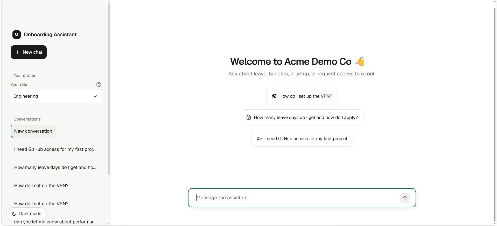
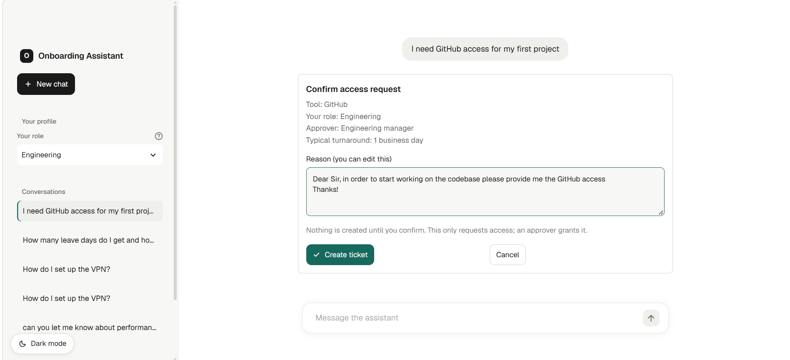

# Onboarding Assistant

**Product management case study · AI onboarding · retrieval-augmented generation · human-in-the-loop access requests**

> An onboarding assistant that helps new hires find policy answers, routes sensitive questions to HR, and submits work-tool access requests only after the employee confirms.

**Product case study and artifacts:** [Open the Confluence space](https://guptavaibhav2005.atlassian.net/wiki/x/AQAN) — Overview, PRD, Risk Register, Roadmap, and Evaluation Report.

**Demo status:** Runs locally; it is not deployed. The demo uses a fictional company and synthetic policy documents. It has not been evaluated with real employees.

## Product overview

New hires often need quick answers about leave, benefits, VPN setup, and work tools. The assistant searches onboarding policies and gives cited answers, says when it cannot find support, and routes sensitive topics to a human. For access requests, it checks role eligibility and shows a confirmation card before creating a Jira ticket. A human approver grants access; the assistant does not.

### Target users

- **Primary:** employees in their first 30 days.
- **Secondary:** People Team and IT approvers handling escalations and access requests.
- **Demo scope:** Acme Demo Co, with 11 synthetic Markdown policy documents.

### Product principles

- **Ground answers in policy:** show citations with source details so employees can verify answers.
- **Refuse instead of guessing:** direct employees to the right contact when the policies do not support an answer.
- **Keep sensitive conversations human:** route topics such as harassment, health, legal matters, visas, and pay negotiation to HR.
- **Make consequential actions explicit:** enforce role checks in code, require confirmation before a Jira request, prevent duplicate submissions, and describe the ticket as a request rather than a grant.

## Frontend screenshots

### Welcome and question discovery

The home screen lets a new hire select a role and start with suggested questions about VPN setup, leave, or tool access.



### Access request confirmation

Before creating a Jira ticket, the confirmation card shows the requested tool, employee role, approver, typical turnaround, and an editable business reason. The employee can create the request or cancel it.



## Evaluation

The latest full run evaluated **90 synthetic cases** (70 core and 20 harder cases) using `openai/gpt-oss-120b` at temperature `0.1`.

| Measure | Result |
| --- | ---: |
| Overall | 87/90 passed (96.7%) |
| Retrieval hit rate | 49/49 (100%) |
| Citation rate | 48/49 (98.0%) |
| Sensitive-topic escalation | 15/15 |
| False escalation rate | 0/49 (0%) |

The suite is small, synthetic, single-turn, and scored with rule-based checks. These results describe this test set and configuration; they do not establish production readiness or real-world usefulness.

### Follow-up from the latest run

- **F25 — VPN wording check:** the answer used “isn't enabled” while the scorer expected the literal word “not”; review the answer and rubric.
- **H02 — Expense details:** the answer omitted ExpenseDesk and did not explain the superseded Rs 600 limit.
- **H06 — Multi-intent request:** a combined access and policy question produced no final answer.

See the [Confluence Evaluation Report](https://guptavaibhav2005.atlassian.net/wiki/spaces/OA/pages/819201) for category results, full findings, limitations, and the attached run report. No real-user pilot is approved; privacy and pilot decisions remain release gates.

## How it works

1. A new hire asks a question in the Streamlit interface and selects a role.
2. The LangGraph workflow searches the policy index and produces a cited answer or a clear refusal.
3. Sensitive topics are routed to HR.
4. For tool access, the application checks role eligibility and gathers a business reason.
5. The user reviews and confirms the request before Jira ticket creation; actions are recorded for later analysis.

## Tech stack

- **UI:** Streamlit
- **Orchestration:** LangGraph
- **Language model:** `openai/gpt-oss-120b` through Groq
- **Retrieval:** LangChain, Chroma, and the `BAAI/bge-m3` embedding model
- **Workflow state and audit data:** SQLite
- **Jira requests:** MCP integration when Jira credentials and the MCP runner are configured

## Run locally

### Requirements

- Python and pip
- A Groq API key
- Internet access on the first run to download the `BAAI/bge-m3` embedding model (about 2 GB)

From the `chatbot_with_ui` folder, create and activate a virtual environment, then install the dependencies:

```powershell
python -m venv .venv
.\.venv\Scripts\Activate.ps1
python -m pip install --upgrade pip
python -m pip install -r requirements.txt
```

Create a `.env` file in the project folder and add your own key:

```dotenv
GROQ_API_KEY=your_groq_api_key
COMPANY_NAME=Acme Demo Co
```

Do not commit `.env` or paste API tokens into issues, screenshots, or source control. `.env` is ignored by Git.

Build the local policy index, then start the app:

```powershell
python rag.py --ingest
streamlit run frontend.py
```

Streamlit prints the local URL to open in your browser. Access requests are stored locally when Jira is not configured.

### Optional Jira integration

To create Jira issues, configure the following values in `.env` and make sure the `uvx` command and `mcp-atlassian` server are available:

```dotenv
JIRA_BASE_URL=https://your-site.atlassian.net
JIRA_EMAIL=you@example.com
JIRA_API_TOKEN=your_jira_api_token
JIRA_PROJECT_KEY=YOUR_PROJECT_KEY
```

Use a Jira API token with only the access needed for the demo. Without all four Jira settings, the app uses local ticket records instead of creating Jira issues.

## Run the evaluations

Run these commands from the `chatbot_with_ui` folder:

```powershell
python evals/run_evals.py --limit 10 --label smoke
python evals/run_evals.py --set all --label full
```

Evaluation reports are written to `evals/results/`. For LangSmith experiments, install `langsmith` and configure `LANGSMITH_API_KEY` and `LANGSMITH_TRACING=true`; see [`evals/README.md`](evals/README.md) for options.

## Project structure

| Path | Purpose |
| --- | --- |
| `frontend.py` | Streamlit chat interface and confirmation card |
| `backend.py` | LangGraph conversation flow and human approval pause |
| `rag.py` | Policy ingestion, indexing, retrieval, and relevance filtering |
| `actions.py` | Role rules, Jira/local ticket creation, deduplication, and audit logging |
| `docs/` | Synthetic onboarding policies, including an outdated expense policy for conflict testing |
| `evals/` | Evaluation cases, scoring, scripts, and reports |
| `assets/screenshots/` | Frontend screenshots shown above |

## Roadmap and risks

The next priorities are to resolve or explain F25, fix H02 and H06, add focused regression checks, test against approved representative documents, and complete privacy and pilot planning before any real-user pilot. The [Confluence Roadmap and Risk Register](https://guptavaibhav2005.atlassian.net/wiki/spaces/OA/pages/688132) track the broader plan and mitigations.

## Product documentation

For the full product case study—including the [PRD](https://guptavaibhav2005.atlassian.net/wiki/spaces/OA/pages/753665), [Risk Register](https://guptavaibhav2005.atlassian.net/wiki/spaces/OA/pages/786433), [Roadmap](https://guptavaibhav2005.atlassian.net/wiki/spaces/OA/pages/688132), and [Evaluation Report](https://guptavaibhav2005.atlassian.net/wiki/spaces/OA/pages/819201)—visit the [Onboarding Assistant Confluence space](https://guptavaibhav2005.atlassian.net/wiki/x/AQAN).
